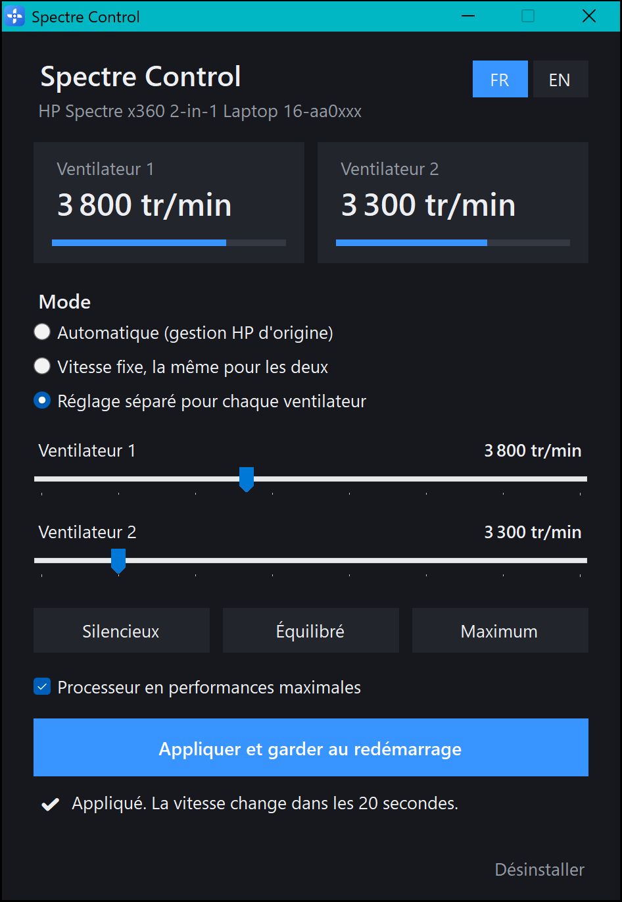

<div align="center">


# Spectre Control

**Contrôle les ventilateurs de ton PC portable HP, sans passer par myHP.**

Ventilateurs au maximum, réglage séparé pour chaque ventilateur, et ton choix est gardé au redémarrage.

### [⬇️ Télécharger Spectre Control](https://github.com/NeelTTV/spectre-fan-control/releases/latest/download/SpectreControl.exe)

*Windows 10 / 11 · 50 Ko · rien d'autre à installer · 🇫🇷 Français / 🇬🇧 English*



</div>

---

## Le problème

Sur les HP Spectre récents, l'application **myHP** ne propose que trois modes, et aucun ne convient :

| Mode myHP | Performances | Ventilateurs |
|---|---|---|
| Smart Sense | 🐌 bridées | moyens |
| Refroidissement | 🐌 bridées | ✅ forts |
| Performance | ✅ bonnes… | ❌ faibles, donc le PC chauffe et finit par ralentir |

**Spectre Control** permet d'avoir les deux à la fois : le processeur à fond **et** les ventilateurs à fond.

## Installation (2 minutes)

1. **Télécharge** [SpectreControl.exe](https://github.com/NeelTTV/spectre-fan-control/releases/latest/download/SpectreControl.exe).
2. **Double-clique** sur le fichier.
   > Windows peut afficher **« Windows a protégé votre ordinateur »**. C'est normal pour une petite appli gratuite qui n'a pas de certificat payant.
   > Clique sur **Informations complémentaires**, puis sur **Exécuter quand même**.
3. Clique sur **Oui** dans la fenêtre de Windows (droits administrateur), puis sur **Oui** pour installer.

C'est fini 🎉 L'appli est sur ton **Bureau** et dans le **menu Démarrer**. Tu peux l'**épingler à la barre des tâches** (clic droit sur l'icône → *Épingler à la barre des tâches*).

## Utilisation

1. Dans myHP, choisis le mode **Performance** (une seule fois).
2. Ouvre **Spectre Control** et choisis un mode :
   - **Automatique** : la gestion HP d'origine.
   - **Vitesse fixe** : les deux ventilateurs à la même vitesse. Les boutons *Silencieux*, *Équilibré* et *Maximum* règlent la vitesse en un clic.
   - **Réglage séparé** : une vitesse différente pour chaque ventilateur.
3. Laisse **Processeur en performances maximales** coché pour avoir toute la puissance.
4. Clique sur **Appliquer et garder au redémarrage**.

Ton réglage est réappliqué tout seul à chaque démarrage et à chaque sortie de veille. L'appli n'a pas besoin de rester ouverte.

**Langue** : boutons **FR / EN** en haut à droite. Au premier lancement, l'appli prend la langue de Windows.

## Questions fréquentes

<details>
<summary><b>Mon PC est-il compatible ?</b></summary>

Testé sur le **HP Spectre x360 16 (16-aa0xxx, Intel Core Ultra 7 155H, RTX 4050)**.

D'autres PC portables HP récents (Spectre, Envy, Omen, Victus…) utilisent la même interface BIOS et devraient fonctionner. L'appli vérifie toute seule au lancement : si ton PC n'est pas compatible, elle te le dit et ne change rien.

Ça marche chez toi sur un autre modèle ? [Dis-le dans une issue](https://github.com/NeelTTV/spectre-fan-control/issues) pour qu'on l'ajoute à la liste !
</details>

<details>
<summary><b>Comment revenir à la gestion HP d'origine ?</b></summary>

Choisis **Automatique**, clique sur **Appliquer**, puis **redémarre** le PC. Le BIOS garde la vitesse fixe jusqu'au redémarrage : c'est lui qui fonctionne comme ça, pas l'appli.
</details>

<details>
<summary><b>Est-ce que c'est dangereux pour mon PC ?</b></summary>

Non :
- l'appli utilise les commandes officielles du BIOS HP, les mêmes que les outils des PC gaming HP Omen ;
- la vitesse ne peut pas descendre sous **3 000 tr/min**, donc un ventilateur ne peut jamais s'arrêter ;
- le processeur garde ses protections matérielles contre la surchauffe, quoi qu'il arrive.

Ventilateurs au maximum = plus de bruit et un peu plus d'usure, comme quand myHP les fait tourner vite.
</details>

<details>
<summary><b>Pourquoi l'appli demande les droits administrateur ?</b></summary>

Windows réserve l'accès au BIOS aux administrateurs. L'appli le demande **une seule fois**, à l'installation. Ensuite elle s'ouvre directement, grâce à une tâche planifiée Windows.
</details>

<details>
<summary><b>Comment la désinstaller ?</b></summary>

Ouvre Spectre Control, puis clique sur **Désinstaller** en bas à droite. Tout est supprimé : l'appli, les raccourcis, les tâches planifiées et les réglages.
</details>

<details>
<summary><b>Mon antivirus bloque le fichier</b></summary>

C'est un faux positif fréquent avec les petites applis non signées qui touchent au système. Le code source est entièrement dans ce dépôt, et tu peux compiler l'appli toi-même (voir plus bas).
</details>

## Pour les curieux : comment ça marche

Les PC portables HP exposent une interface BIOS via WMI (`root\wmi`, classe `hpqBIntM`). Spectre Control envoie la commande `0x20008` avec :

| Type | Rôle |
|---|---|
| `0x10` | nombre de ventilateurs |
| `0x2D` | vitesse actuelle de chaque ventilateur (en centaines de tr/min) |
| `0x2E` | impose une vitesse à chaque ventilateur (un octet par ventilateur) |

À l'installation, l'appli :
- se copie dans `C:\Program Files\SpectreControl` ;
- crée deux tâches planifiées :
  - **SpectreControl Apply** (compte SYSTEM) réapplique le réglage au démarrage, à la connexion et en sortie de veille ;
  - **SpectreControl GUI** ouvre l'interface en administrateur sans fenêtre UAC ;
- enregistre les réglages dans `C:\ProgramData\SpectreControl\settings.ini`.

L'option *Processeur en performances maximales* règle les paramètres d'alimentation Windows : boost processeur agressif, préférence énergie/performance à 0, aucun cœur parqué.

### Compiler soi-même

Aucun outil à installer : le compilateur C# est fourni avec Windows.

```powershell
git clone https://github.com/NeelTTV/spectre-fan-control
cd spectre-fan-control
powershell -ExecutionPolicy Bypass -File build.ps1
```

L'exécutable est créé dans `dist\SpectreControl.exe`.

---

<sub>Projet indépendant, non affilié à HP Inc. « HP », « Spectre » et « myHP » sont des marques de HP Inc. Utilisation à tes risques, sans garantie (licence MIT).</sub>

<details>
<summary>🇬🇧 English</summary>

**Spectre Control** lets you control the fans of HP laptops (tested on the HP Spectre x360 16-aa0xxx) without myHP: maximum fan speed together with full CPU performance, separate speed per fan, and your setting is re-applied at every boot and resume.

1. [Download SpectreControl.exe](https://github.com/NeelTTV/spectre-fan-control/releases/latest/download/SpectreControl.exe) and double-click it.
2. If SmartScreen warns, click *More info → Run anyway* (the app is free and not code-signed).
3. Accept the admin prompt and choose *Yes* to install. A shortcut appears on the Desktop and in the Start menu, and you can pin it to the taskbar.

Switch the language with the **FR / EN** buttons (top right). In myHP pick *Performance* once, then in Spectre Control choose *Automatic*, *Fixed speed* (both fans) or *Separate speed for each fan*, and click *Apply and keep after restart*. To return to HP's automatic fan control, pick *Automatic*, apply, and restart. To remove everything, click *Uninstall*.

</details>
